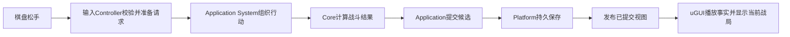

# FightMatch 实际架构与代码阅读指南

2026-10-25。依据主程本轮只读盘点与中央代码核对；本机可恢复检查点为`f94240fa72eb9df4e616fe04c56a1fe3068b73b1`，已独审产品头为PR22 `dece3d8c589742b5ee3d75b2e255c97f6bf2495b`。两者不是同一棵树。本页说明结构和维护成本，不替代GitHub代码审查，不宣称所有代码满足SOLID。

## 1. 当前采用什么架构

准确说法：**分层业务架构＋QFramework组织应用系统＋项目自有uGUI View／Controller。**

QFramework与MVC不是互斥选项：前者是项目采用的组织工具，后者是界面／状态职责的划分方式。当前界面有视图和控制器分离，带有被动视图的特征，但没有统一的IView／Presenter契约，不能统一称为标准MVP；也没有采用MVVM自动数据绑定。业务核心及存档不会因为界面框架改变而另做一套。

QFramework确实参与运行：

- `Assets/ThirdParty/QFramework/QFramework.cs`源码头标`QFramework v1.0`，以Assets内源码和独立程序集随项目保存，不是Packages中的QFramework UPM依赖。
- `Application/FightMatchDemoArchitecture.cs:7`继承`Architecture<FightMatchDemoArchitecture>`，在Init中注册Model及Application／Battle／Lifecycle／Player系统。
- `Host/FightMatchHostSession.cs:71`实际取得Architecture和System，并组装导航／战斗Controller。
- 项目有Command／Query外壳，但主要输入链直接调用System的Prepare／Submit；不能说所有业务都经过QFramework命令总线。
- uGUI页面与Controller为项目自有实现，本次未看到产品采用QFramework UIKit／UIManager的调用。

## 2. 各层做什么

以下路径均位于`Assets/Scripts/FightMatch/`。

| 层／目录 | 主要职责 | 人类阅读入口 |
| --- | --- | --- |
| Core | 纯战斗、成长、库存、历史、数值与业务状态；包括存档编码模型 | `Core/CandidateBattleOperations.cs` |
| Input | 连线手势、首指所有权、路径草稿与取消 | `Input/RouteGesture.cs` |
| Application | 入场、行动、结算等用例；候选提交、恢复与当前视图发布；QFramework系统组织 | `Application/FightMatchDemoArchitecture.cs`、`CandidateApplicationRuntime.cs` |
| Platform | 文件系统适配、写入租约、快照与commit marker、保存结果查询 | `Platform/ILocalSaveStorage.cs`、`LocalSaveStore.cs` |
| Content | 制作数据校验、编译、不可变发布及版本精确绑定 | `Content/PublishedContentCompiler.cs`、`PublishedContentCatalog.cs` |
| Presentation | uGUI/TMP视图、Controller、文本绑定与表现播放 | `Presentation/PlayerBattleController.cs`、`PlayerBattleView.cs` |
| AssetAccess／YooAssetAdapter | 资源能力契约与YooAsset外部实现 | `AssetAccess/FightMatchAssetContracts.cs`、`YooAssetAdapter/YooAssetResourceRuntime.cs` |
| Host | Unity启动、平台选择、资源／语言初始化、系统装配及生命周期 | `Host/FightMatchPlayerHost.cs`、`FightMatchHostSession.cs` |

Core／Input的asmdef禁止引擎引用；Platform和Content也保持普通C#边界。Application依赖Core／Platform／Content／QFramework，Presentation直接依赖Application等层，Host负责装配。因此它是实用分层，不能声称所有依赖都严格向内的Clean Architecture。

项目没有一个独立的`Persistence`目录承担全部保存职责：编码在Core，存储协议和IO在Platform，业务提交协调在Application。读代码时按这三个责任定位。

## 3. 一次连线如何到达存档和画面

按这条路径阅读，而不是先遍历所有历史任务记录：

1. `CandidateBoardElement.cs:134`接收指针松手。
2. `CandidateBoardInputController.cs:210`构造Attack草案，`:305`调用Prepare／Submit。
3. `CandidateBattleApplicationSystem.cs:29`和`CandidateBattleApplicationBuilders.cs:59`组织调用Core。
4. `CandidateBattleOperations.cs:21`依序处理攻击、敌回合和阶段变化。
5. `CandidateApplicationRuntime.cs:181`起准备提交；`LocalSaveStore.cs:155`起保存snapshot、校验并提升，再保存commit marker。
6. `CandidateApplicationRecovery.cs:124`起确认后发布当前视图；输入Controller发Changed／PresentationReady。
7. `CandidateBattlePlaybackController`与View播放已有事实；Skip结束表现，不重新计算伤害或发奖励。

以上行号绑定本次工作区输入；后续改动应通过符号名定位。一次业务先保存，再表现，是重要不变量，不能为了缩短调用链而移除。

## 4. SOLID落实情况

| 原则 | 当前依据 | 仍需谨慎的地方 |
| --- | --- | --- |
| S：单一职责 | 战斗计算、手势、持久IO和显示已分层 | Host同时装配启动、资源、语言、平台和生命周期；构建器兼有UI生成、资源准备与构建。职责有继续拆分空间，长文件本身不直接等于违规。 |
| O：对扩展开放 | 平台存储和资源适配可增加实现 | 新业务操作往往还要修改流程分派、界面和文本映射；不能保证所有扩展都不改旧类。 |
| L：实现可替换 | 有多种平台存储实现及共同契约 | 本次未做完整替换性验证，不能根据存在接口就断言全部满足LSP。 |
| I：接口聚焦 | `ILocalSaveStorage`、资产Acquire及资源运行契约职责相对明确 | 每次新增远端能力要检查调用方所需最小能力，避免把所有平台服务塞到一个大接口。 |
| D：依赖抽象 | 存储和资源外部实现已有抽象与工厂注入 | Controller仍依赖具体System，Application直接引用Platform；不是全项目完全依赖倒置。 |

结论：SOLID有实际落点，尤其是纯规则与外部IO分离；不能给“全面符合”的认证。首Demo验收通过证明既定行为，不等于自动证明架构已没有维护成本。

## 5. 人类是否容易读

当前判断：**能按模块定位，但新接手者读懂完整用例仍需领域背景。**

有利之处：目录职责明确、业务结果显式、核心不依赖Unity、关键保存和恢复路径有证据。负担主要是跨文件调用深、状态与恢复守卫多、Candidate／Prepared／Intent／Token等术语密集，以及部分同一行压缩多个语句／字符串诊断映射。

本机代表性规模（不是代码质量评分）：

- `FightMatchPlayerHost.cs`725行；其中`OpenResourcesAsync`约74行。
- `PlayerBattleView.cs`484行，主类约472行。
- `PlayerNavigationView.cs`636行，但主View约297行，后半还有Bindings辅助类；不能把文件总长冒称单类总长。
- 本机构建器2,775行，准确已审发布副本1,285行；约1,490行本地额外内容属于版本差异，不能全部归入已审交付。已审副本本身仍有UI生成／资源准备／构建多个职责。

## 6. 后续设计与实现的阅读要求

- 每个功能包写清入口、状态唯一拥有者、调用顺序、失败／恢复和可观察结果。
- 先沿一个真实玩家用例读通，再讨论模块边界；避免只按文件数量或SOLID口号增加抽象层。
- 延续当前QFramework和uGUI路线。触及Host／构建器时，根据实际变化将可独立职责提取；不先做全仓重构。
- 新代码使用可读命名和正常分行；注释解释顺序、不变量和选择原因，避免逐句复述。
- 保留必要的提交／恢复边界和防重复规则；简化代码不得削弱保存语义。
- 不为统一外观而全局重命名Candidate、改序列化类型或新增单一实现接口。
- 新源码仍交GitHub PR Code Review，只补改动影响的检查；不把这份阅读说明当独立审查通过。
